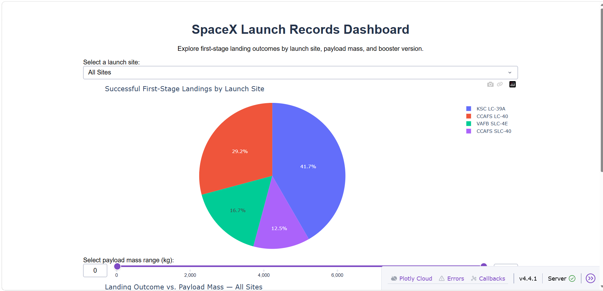
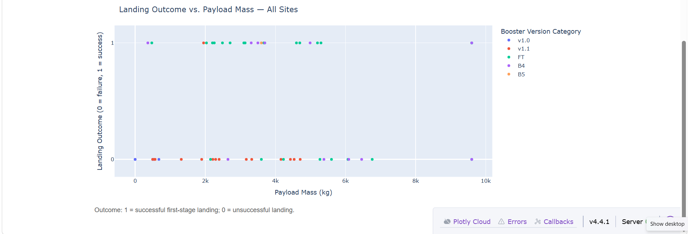
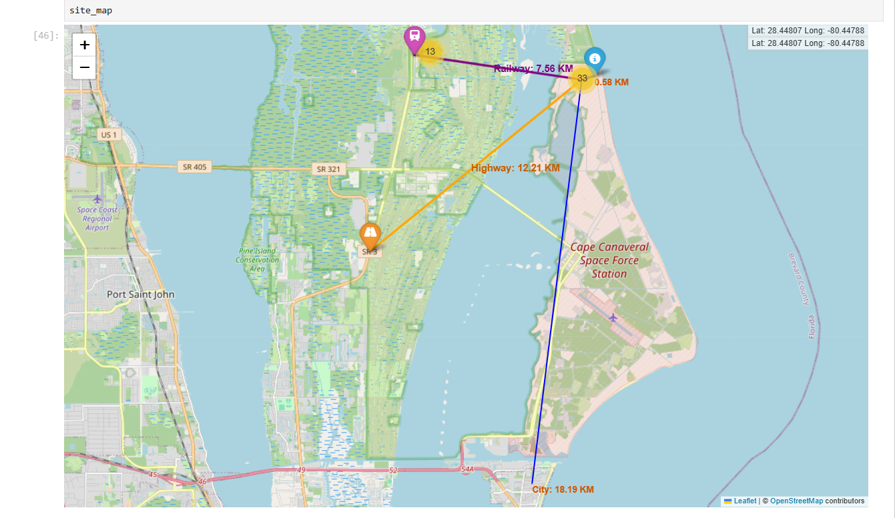

# SpaceX Falcon 9 Landing Prediction — Data Science Capstone

**Author:** Eke Uka Okoro  
**Programme:** IBM Data Science Professional Certificate — Applied Data Science Capstone  
**Repository:** https://github.com/eokorouka-jpg/SpaceX-Falcon9-Data-Science-Capstone

## 1. Project Overview

This project investigates the factors associated with successful landings of SpaceX Falcon 9 first-stage boosters.

Using Python, SQL, exploratory data analysis, interactive visualisations and machine learning, the project examines historical launch records and develops classification models to predict first-stage landing outcomes.

The project demonstrates an end-to-end data science workflow involving:

- Data collection through APIs and web scraping
- Data cleaning and feature engineering
- Exploratory analysis using Python and SQL
- Interactive geographical analysis using Folium
- Dashboard development using Plotly Dash
- Predictive modelling and model evaluation
- Communication of analytical findings

## 2. Business Problem

SpaceX's reusable rocket technology aims to reduce the costs associated with space launches.

Recovering and reusing first-stage boosters can reduce the need to manufacture new hardware for every launch.

Understanding which launch characteristics are associated with successful booster recovery can support the analysis of launch performance and reusability.

**Main research question:**

Can historical launch characteristics be used to predict whether a Falcon 9 first-stage booster will land successfully?

## 3. Project Objectives

1. Collect historical Falcon 9 launch data from the SpaceX API and Wikipedia.
2. Clean, transform and prepare datasets for analysis.
3. Explore landing outcomes across launch sites, payload masses, orbit types and booster versions.
4. Use SQL to investigate historical launch records.
5. Analyse launch-site geography using Folium.
6. Develop an interactive Plotly Dash dashboard.
7. Train and evaluate machine-learning classification models.
8. Present findings, limitations and recommendations.

## 4. Technologies and Tools

| Category | Technologies |
|---|---|
| Programming | Python, SQL |
| Data manipulation | Pandas, NumPy |
| Visualisation | Matplotlib, Seaborn, Plotly |
| Interactive dashboard | Plotly Dash |
| Geographical analysis | Folium |
| Machine learning | Scikit-learn |
| Database | SQLite |
| Development | Jupyter Notebook, VS Code |
| Version control | GitHub |

## 5. Project Methodology

### 5.1 Data Collection

Collected Falcon 9 launch information using the SpaceX API and Wikipedia web scraping.

The data included launch dates, launch sites, payload characteristics, booster versions, mission outcomes and landing outcomes.

### 5.2 Data Wrangling

Prepared the datasets by:

- Examining missing and inconsistent values.
- Creating binary landing outcome labels.
- Selecting relevant launch characteristics.
- Encoding categorical variables for machine learning.
- Preparing datasets for exploratory and predictive analysis.

Different stages of the project used different datasets:

| Analysis | Dataset size |
|---|---:|
| SQL launch records | 101 records |
| Plotly Dash analysis | 56 records |
| Machine-learning analysis | 90 records |
| Encoded ML feature matrix | 90 rows × 80 features |

These datasets should not be treated as identical samples.

### 5.3 Exploratory Data Analysis

Exploratory analysis examined:

- Landing outcomes by launch site
- Payload mass and landing success
- Orbit types and landing performance
- Booster-version characteristics
- Changes in landing performance over time

Python visualisations and SQL queries were used to investigate these relationships.

### 5.4 SQL Exploratory Analysis

SQL queries were used to examine launch-site activity, payload characteristics, booster versions and historical landing outcomes.

Selected findings included:

- **First successful ground-pad landing:** 22 December 2015.
- **NASA CRS total payload mass:** 45,596 kg.
- **Average payload mass for Falcon 9 v1.1:** 2,928.4 kg.
- **Mission outcomes:** 98 records labelled `Success`, one additional record labelled `Success ` with trailing whitespace, one labelled `Success (payload status unclear)` and one labelled `Failure (in flight)`.

The mission-outcome results demonstrate why consistent text formatting matters when analysing categorical data.

Mission success and first-stage booster landing success are different measures.

### 5.5 Folium Geographical Analysis

An interactive Folium map was developed to examine the geographical surroundings of SpaceX launch facilities.

Using **CCAFS LC-40** as the reference site, straight-line distances were calculated to selected geographical points.

| Geographical feature | Distance |
|---|---:|
| Selected coastline point | 0.58 km |
| Selected railway point | 7.56 km |
| Selected highway point — Florida SR 3 | 12.21 km |
| Selected city point | 18.19 km |

**Geographical findings:**

- The selected coastline point was less than 1 km from CCAFS LC-40.
- Railway infrastructure was identified in the surrounding area.
- Florida State Road 3 provided a reference point for examining highway proximity.
- The selected city point was approximately 18.19 km away.

The analysis illustrates how geographical location, transportation infrastructure and coastal access can be investigated using spatial data.

**Important limitation:** These are straight-line distances to selected points, not verified nearest-feature distances. They should not be interpreted as universal safety requirements or evidence of why SpaceX selected a particular site.

### 5.6 Plotly Dash Interactive Dashboard

A Plotly Dash application was developed to explore first-stage landing outcomes interactively.

The dashboard includes:

- A launch-site dropdown filter
- A pie chart of successful landings by launch site
- A payload-mass range slider
- A scatter plot of payload mass against landing outcome
- Booster-version categories for comparing results

The dashboard supports exploration of 56 historical launch records.

#### Landing Success by Launch Site

| Launch site | Total launches | Successful landings | Success rate |
|---|---:|---:|---:|
| CCAFS LC-40 | 26 | 7 | 26.92% |
| CCAFS SLC-40 | 7 | 3 | 42.86% |
| KSC LC-39A | 13 | 10 | 76.92% |
| VAFB SLC-4E | 10 | 4 | 40.00% |

**Key finding:** KSC LC-39A recorded the highest landing success rate in this dataset, at 76.92%.

In the dashboard's all-sites pie chart, KSC LC-39A accounted for **41.7% of all successful landings**. This is its share of successful landings, not its individual landing success rate.

#### Payload Mass Analysis

| Payload range | Successful landings | Total launches | Success rate |
|---|---:|---:|---:|
| 0–2,000 kg | 3 | 13 | 23.08% |
| 2,000–4,000 kg | 13 | 21 | 61.90% |
| 4,000–6,000 kg | 5 | 13 | 38.46% |
| 6,000–8,000 kg | 0 | 4 | 0.00% |
| 8,000–10,000 kg | 3 | 5 | 60.00% |

The 2,000–4,000 kg range had the highest observed landing success rate among the larger payload groups.

These results are descriptive and do not establish that payload mass alone determines landing success.

### 5.7 Machine Learning Classification

The machine-learning dataset contained 90 launch records and 80 encoded features.

An 80/20 training and testing split was used, producing 18 test records.

Four classification algorithms were evaluated using GridSearchCV with 10-fold cross-validation:

1. Logistic Regression
2. Support Vector Machine
3. Decision Tree
4. K-Nearest Neighbours

#### Model Performance

| Model | Test accuracy | Correct predictions |
|---|---:|---:|
| Logistic Regression | 83.33% | 15/18 |
| Support Vector Machine | 83.33% | 15/18 |
| K-Nearest Neighbours | 83.33% | 15/18 |
| Decision Tree | 77.78% | 14/18 |

Logistic Regression, SVM and KNN achieved the joint-highest test accuracy of **83.33%**.

For these three models, the confusion matrix was:

| | Predicted unsuccessful | Predicted successful |
|---|---:|---:|
| Actual unsuccessful | 3 | 3 |
| Actual successful | 0 | 12 |

This indicates that the three models correctly classified all 12 successful landing cases in the test set, while incorrectly predicting success for three unsuccessful cases.

## 6. Key Business and Analytical Findings

**1. Launch-site performance varied considerably.**

KSC LC-39A recorded the highest observed landing success rate among the four launch-site labels in the dashboard dataset.

**2. Payload mass was associated with different historical landing outcomes.**

Landing success rates varied across payload ranges, although sample sizes were relatively small.

**3. Coastal geography is an important characteristic of the analysed launch site.**

The CCAFS LC-40 proximity analysis showed a selected coastline point only 0.58 km away.

**4. Transportation infrastructure is present in the wider launch-site area.**

Selected railway and highway points were identified and mapped using Folium.

**5. Multiple classification models achieved similar predictive performance.**

Logistic Regression, SVM and KNN each achieved 83.33% accuracy on the held-out test set.

## 7. Project Limitations

The project has several important limitations:

- The machine-learning test set contained only 18 observations.
- Historical landing performance may not generalise to future launches.
- Different analysis stages used datasets with different sizes and coverage.
- Some launch-site labels may require additional standardisation.
- Folium distances were calculated to selected geographical points rather than verified nearest features.
- Predictive accuracy alone does not establish causal relationships.
- The machine-learning workflow should be reviewed to ensure preprocessing is fitted only on training data, avoiding potential data leakage.

Further analysis could use a larger dataset, leakage-safe pipelines, repeated cross-validation and additional model evaluation metrics.

## 8. Project Files and Deliverables

### Project File Links

- [Plotly Dash Application](spaceX/spacex-dash-app.py)
- [Dashboard Analysis Script](spaceX/spacex_dashboard_analysis.py)
- [Dashboard Dataset](spaceX/spacex_launch_dash.csv)
- [Machine Learning Prediction Notebook](SpaceX_Machine Learning Prediction.ipynb)
- [Final SpaceX Capstone Presentation (PDF)](SpaceX_Capstone_Project.pdf)

The repository contains notebooks, datasets and scripts covering:

- SpaceX API data collection
- Wikipedia web scraping
- Data cleaning and feature engineering
- SQL exploratory data analysis
- Python exploratory data analysis
- Folium geographical mapping
- Plotly Dash dashboard development
- Machine-learning classification
- Dashboard analysis and findings
- Final capstone presentation

**Final presentation:** See the PDF presentation included in this repository.

**Interactive map:** See the Folium notebook and exported map, where available.

**Dashboard application:** Run the Plotly Dash Python application locally with the required CSV dataset.

## Project Visualisations

### 1. Plotly Dash — Landing Success by Launch Site

The pie chart shows each launch site's share of all successful first-stage landings.

### 2. Plotly Dash — Payload Mass and Landing Outcomes

The scatter plot explores payload mass, booster version and landing outcomes.

### 3. Folium — Launch Site Geographical Analysis

The map displays selected geographical points and straight-line distances from CCAFS LC-40.

## 9. Conclusion

This SpaceX Falcon 9 Data Science Capstone demonstrates an end-to-end analytical workflow, combining data collection, preparation, exploratory analysis, interactive visualisation and predictive modelling.

The analysis identified differences in historical landing performance across launch sites, payload ranges and booster versions.

The geographical analysis provided additional context about coastal proximity and transportation infrastructure around CCAFS LC-40.

Among the four machine-learning models evaluated, Logistic Regression, SVM and KNN achieved the highest observed test accuracy of **83.33%**.

The project demonstrates practical skills in Python, SQL, data analysis, dashboard development, geographical visualisation and machine learning, while highlighting the importance of sample size, data quality and careful model validation.

## 10. Author

**Eke Uka Okoro**

Aspiring Data Analyst | Data Scientist | Machine Learning Practitioner

GitHub: https://github.com/eokorouka-jpg

Project repository: https://github.com/eokorouka-jpg/SpaceX-Falcon9-Data-Science-Capstone
